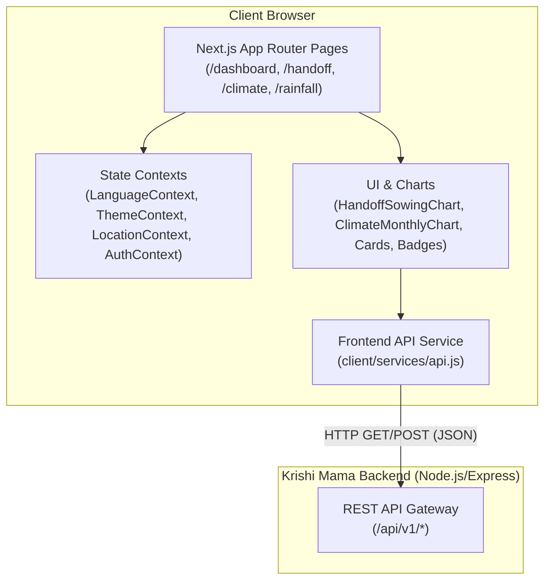

# Krishi Mama — Frontend (`Krishi_Client`)

**Climate-Informed Agricultural Decision Support for Bangladesh**  
*Transforming 25 Years of Historical NASA Earth Observations into Actionable Crop-Transition Evidence*

Developed for the **NASA International Space Apps Challenge 2026**  
**Selected Challenge:** Field Shift: Adapting Farms with NASA Data  
**Team:** NeuralMesh  

- **Frontend Repository:** [https://github.com/shahed-hassan-fz-rabbi/Krishi_Client](https://github.com/shahed-hassan-fz-rabbi/Krishi_Client)
- **Backend Repository:** [https://github.com/shahed-hassan-fz-rabbi/Krishi_server](https://github.com/shahed-hassan-fz-rabbi/Krishi_server)
- **Deployment Status:** Configured for local development and demonstration; see [Installation and Local Development](#installation-and-local-development).

---

## Table of Contents

1. [Project Overview](#project-overview)
2. [The Agricultural Problem](#the-agricultural-problem)
3. [Our Solution](#our-solution)
4. [Key Features and Implementation Status](#key-features-and-implementation-status)
5. [User Interface and Screenshots](#user-interface-and-screenshots)
6. [Frontend Architecture](#frontend-architecture)
7. [Backend API Integration](#backend-api-integration)
8. [Installation and Local Development](#installation-and-local-development)
9. [User Experience and Accessibility](#user-experience-and-accessibility)
10. [Scientific and Technical Limitations](#scientific-and-technical-limitations)
11. [Use of Artificial Intelligence](#use-of-artificial-intelligence)
12. [License and Acknowledgments](#license-and-acknowledgments)

---

## Project Overview

**Krishi Mama** (কৃষি মামা — "Farmer's Maternal Uncle / Trusted Advisor") is a transparent, climate-informed decision-support application built to help farmers and agricultural extension workers in Bangladesh navigate vulnerable crop-transition windows.

Rather than offering black-box weather forecasts or unsupported yield predictions, Krishi Mama grounds its insights in **25 years (2001–2025) of verified NASA POWER daily agroclimatology observations**. The frontend provides an accessible, bilingual (English and Bangla) interface that communicates historical climate variability, dry-day opportunities, and statistical shifts across key cropping cycles.

> **Disclaimer:** Krishi Mama was developed as an open-source project submission for the NASA International Space Apps Challenge 2026. It is not an official NASA product, nor has it been certified or endorsed by NASA or any governmental agricultural authority.

---

## The Agricultural Problem

In Bangladesh's intensive cropping systems, the transition period between the monsoon season and the dry winter season is one of the most critical and climate-sensitive phases of the agricultural calendar:

1. **The Post-Monsoon Bottleneck (Aman → Mustard):** Farmers harvest Monsoon T. Aman rice in late October and prepare their land for Winter Rabi Mustard in early November. Mustard requires a prompt sowing window (typically November 1–20) before rising winter temperatures or aphid infestations reduce viability.
2. **Soil Workability Constraints:** Preparing wet paddy fields for seed germination requires tillage workability, which depends on consecutive dry days. Late-monsoon rains in late October or early November saturate soils, delaying seedbed preparation.
3. **Lack of Accessible Historical Evidence:** Farmers frequently lack localized historical context regarding how rainfall patterns and sowing opportunity frequencies have varied over past decades.

Krishi Mama addresses this information gap by synthesizing a quarter-century of NASA Earth observation data into understandable historical evidence.

---

## Our Solution

Krishi Mama provides a modern web application designed for desktop and mobile devices:

- **Agroclimate Overview Dashboard (`/dashboard`):** Retrospective historical climate analysis aggregating multi-parameter historical normals (precipitation, temperature, humidity, and solar radiation).
- **Crop Handoff Planner (`/handoff`):** An interactive tool analyzing 25 years of daily observations for specific crop transitions:
  - **Monsoon T. Aman Rice → Winter Rabi Mustard:** Sowing window November 1–20; harvest context late October (October 16–31).
  - **Boro Rice → Aus Rice:** Sowing window April 1–20; harvest context late March–early April.
- **Sowing Opportunity Analysis:** Evaluates retrospective yearly workability against project-defined dry-day criteria (5 consecutive dry days for Aman–Mustard; 4 consecutive dry days for Boro–Aus).
- **Period Shift Comparisons:** Displays statistical comparisons between two historical periods (2001–2012 vs. 2013–2025) using Welch's t-test and Mann–Whitney U test calculations performed deterministically by the Python scientific engine.
- **Bilingual Interface:** Instant switching between English and Bangla across navigation, data charts, disclosures, and tooltips.
- **Farmer-First Tools:** Low-bandwidth SMS advisory generator with one-click copy, and clean print-to-PDF formatting for extension officers.
- **Open-Access Guest Evaluation:** Direct access to all analytics without registration barriers, facilitating seamless competition review.

---

## Key Features and Implementation Status

To ensure absolute transparency for competition evaluators, the table below documents the exact implementation state of all user-facing features:

| Feature / Module | Route | Status | Description |
|---|---|---|---|
| **Landing Page** | `/` | **Implemented** | Brand introduction, mission overview, and direct navigation links. |
| **Climate Dashboard** | `/dashboard` | **Implemented** | 25-year multi-parameter climate overview powered by `/api/v1/climate/summary`. |
| **Handoff Planner** | `/handoff` | **Implemented** | Crop transition analysis, 25-year sowing opportunity chart, period comparisons, and methodology disclosures. |
| **Rainfall Climatology** | `/rainfall` | **Implemented** | Historical monthly and annual rainfall normals backed by `/api/v1/climate/rainfall`. |
| **Temperature Climatology** | `/climate` | **Implemented** | Mean, maximum, minimum temperatures, and diurnal range series from `/api/v1/climate/temperature`. |
| **NASA Data Catalog** | `/data-sources` | **Implemented** | Verified provenance, point-in-time observation counts (109,572 rows), and parameter specifications from `/api/v1/data-sources`. |
| **Bilingual Localization** | Global | **Implemented** | English and Bangla (`en`/`bn`) switching with custom Bangla typography. |
| **Theme Switching** | Global | **Implemented** | Light and dark mode support with persistent local storage preferences. |
| **SMS Advisory Generator** | `/handoff` | **Implemented** | Plain-text advisory generator (< 160 characters) with clipboard copy confirmation. |
| **Print Brief Report** | `/handoff` | **Implemented** | Clean `@media print` layout hiding web navigation for A4 print and PDF export. |
| **Local Auth (Email/PW)** | `/login`, `/register` | **Implemented** | Client form validation and backend session management via HTTP-only cookies. |
| **Google Authentication** | `/login`, `/register` | **Limited (Placeholder)** | Single-Sign-On button is rendered as an inactive placeholder (`disabled`, `opacity-60`). |
| **Guest Access Mode** | `/(app)/*` | **Implemented** | Open-access guest evaluation across all analytical pages without login barriers. |
| **SMAP Soil Moisture** | `/soil-moisture` | **Implemented** | Real NASA SMAP Enhanced Level-3 9 km volumetric soil moisture observations (`SPL3SMP_E V006`), bitmask quality filtering, and surface temperature. |
| **MODIS Vegetation (NDVI)**| `/vegetation` | **Implemented** | Real NASA Terra MODIS 250 m 16-day vegetation metrics (`MOD13Q1.061`), scaled NDVI/EVI trends, composite day-of-year tracking, and pixel reliability quality filtering. |
| **Interactive GIS Map** | `/map` | **Implemented** | Interactive Leaflet GIS dashboard rendering official BBS 2020 Admin-2 district boundary polygons (`bgd_admbnda_adm2_bbs_20201113`), NASA observation overlays, and spatial metrics. |
| **Crop Calendar Guide** | `/crop-calendar` | **Implemented** | Source-backed phenology calendar (BAMIS/DAE/BRRI/BARI) for Aman, Boro, Aus, and Mustard across Cumilla & Chattogram agro-ecological regions with NASA satellite alignment. |

---

## User Interface and Screenshots

The Krishi Mama interface emphasizes visual clarity, responsive adaptability, and high data density suited for both technical judges and agricultural specialists.

### Visual Styling Highlights
- **Agricultural Color Palette:** Forest Green (`#1b4332`), Emerald (`#2d6a4f`), Amber Sand, and Dark Slate.
- **Dark Theme Ergonomics:** Deep green-black surfaces (`#0d1712`) reducing eye strain in field environments.
- **Data Visualizations:** SVG bar and area charts built with accessible ARIA descriptions and responsive SVG viewports.

### Capturing and Adding Screenshots
Screenshots are not bundled into the Git repository to minimize repository bloat. To capture and add screenshots for presentation:
1. Run the frontend locally on port 3000 alongside the backend on port 5000.
2. Capture screenshots of the following pages and save them to `client/public/screenshots/`:
   - `01-dashboard-desktop.png`: Multi-parameter climate dashboard view (`/dashboard`).
   - `02-handoff-planner-desktop.png`: 25-year crop handoff sowing opportunity chart and statistical disclosures (`/handoff`).
   - `03-bilingual-bangla.png`: Interface demonstrated in Bangla mode.
   - `04-mobile-view.png`: Mobile drawer and touch bottom navigation.

---

## Frontend Architecture

The frontend is constructed with the Next.js App Router, using client-side React 19 components with pure JavaScript and Tailwind CSS v4.



### Component Hierarchy
- **`app/(app)/layout.js`:** Wraps all analytical pages in the shared application layout containing the desktop sidebar (`AppSidebar`), mobile header (`MobileTopbar`), and mobile bottom dock (`BottomNav`). The layout operates in open-access mode for competition evaluation.
- **`contexts/LanguageContext.js`:** Manages language toggling (`en` / `bn`), attaches `<html lang="...">`, and provides the `t(key)` translation function.
- **`contexts/ThemeContext.js`:** Handles light/dark themes by toggling the `dark` class on the root document.
- **`contexts/LocationContext.js`:** Manages the active district selection (Cumilla or Chattogram).
- **`services/api.js`:** Robust fetch wrapper providing unified timeouts (15–30s), error classification (`REQUEST_TIMEOUT`, `NETWORK_ERROR`), and JSON envelope unwrapping.

---

## Backend API Integration

The frontend communicates with the Krishi Mama REST API using standard JSON request/response envelopes:

```
GET http://localhost:5000/api/v1/...
```

### Consumed Endpoints

| Endpoint | Method | Purpose | Key Parameters |
|---|---|---|---|
| `/health` | `GET` | Verifies backend connectivity, database status, and dataset readiness. | None |
| `/districts` | `GET` | Fetches enabled districts, exact coordinates, and default selection. | None |
| `/climate/summary` | `GET` | Fetches 25-year climate summary across 4 parameter groups. | `district` (`cumilla` \| `chattogram`) |
| `/climate/rainfall` | `GET` | Fetches aggregated rainfall series and monthly normals. | `district`, `grouping` (`monthly` \| `annual`) |
| `/climate/temperature`| `GET` | Fetches temperature normals and diurnal range distributions. | `district`, `metric` (`t2m` \| `all`) |
| `/climate/handoff` | `GET` | Executes Python handoff analysis for crop transition windows. | `district`, `transition` (`aman-mustard` \| `boro-aus`) |
| `/data-sources` | `GET` | Fetches NASA POWER dataset catalog, coverage dates, and provenance. | None |
| `/auth/login` | `POST` | Authenticates user credentials and establishes HTTP-only session. | `{ email, password }` |
| `/auth/register` | `POST` | Registers new user account with default role `farmer`. | `{ name, email, password, preferredDistrict }` |
| `/auth/me` | `GET` | Restores current authenticated user profile. | None |

### Standard Response Envelopes
- **Success:** `{ "success": true, "data": { ... }, "meta": { ... } }`
- **Error:** `{ "success": false, "error": { "code": "...", "message": "..." } }`

---

## Installation and Local Development

### Prerequisites
- **Node.js:** Version `18.18.0` or higher (tested on Node 20 / 22 LTS, as required by Next.js 16).
- **npm:** Version `9.x` or higher.
- **Backend Service:** The Krishi Mama Express backend must be running on port `5000` to provide data for the analytical pages.

### Step-by-Step Setup

1. **Clone the Repository:**
   ```bash
   git clone https://github.com/shahed-hassan-fz-rabbi/Krishi_Client.git
   cd Krishi_Client
   ```

2. **Install Dependencies:**
   ```bash
   npm install
   ```

3. **Configure Environment Variables:**
   Copy the provided `.env.example` to `.env.local`:
   ```bash
   cp .env.example .env.local
   ```
   Ensure `.env.local` contains:
   ```env
   # Base URL of the Krishi Mama backend REST API (no trailing slash)
   NEXT_PUBLIC_API_BASE_URL=http://localhost:5000/api/v1
   ```

4. **Run the Development Server:**
   ```bash
   npm run dev
   ```
   Open your browser at [http://localhost:3000](http://localhost:3000).

5. **Production Build and Verification:**
   To test the optimized production build:
   ```bash
   npm run build
   npm run start
   ```

6. **Code Quality and Linting:**
   ```bash
   npm run lint
   ```

---

## User Experience and Accessibility

- **Responsive Adaptability:** Tested across screen widths from 360px mobile viewports to 1440px desktop displays. Tables feature horizontal scroll wrappers (`overflow-x-auto`) to prevent layout clipping.
- **Accessible Chart Semantics:** Data charts declare `role="img"` with descriptive `aria-label` summaries, accompanied by structured data tables for screen-reader navigation.
- **Bilingual Typography:** Uses clean system sans-serif font stacks dynamically paired with Bangla font smoothing (`km-bn`).
- **Resilient State Feedback:** Every data-driven card implements `<LoadingState />` spinners and `<ErrorState />` alerts with retry triggers.

---

## Scientific and Technical Limitations

1. **Retrospective Climatology, Not Weather Forecasting:** Krishi Mama calculates descriptive statistics and historical frequencies from past observations. It does not provide numerical weather predictions or operational weather forecasts.
2. **Historical Frequency vs. Future Probability:** A 100% historical workable window frequency over the past 25 years demonstrates past climate stability, but does not guarantee future field readiness or crop success.
3. **Spatial Resolution:** NASA POWER data provides gridded point interpolations (~0.5° × 0.5° resolution). Observations do not reflect microclimatic field variations or individual farm soil conditions.
4. **Operational Proxy Definition:** The 5-consecutive-dry-day threshold (< 1.0 mm/day for Aman–Mustard) and 4-consecutive-dry-day threshold (for Boro–Aus) are project-defined operational proxies for tillage feasibility, not official WMO or national agronomic regulations.
5. **Simulated Authentication:** Google Single-Sign-On is currently an inactive interface placeholder. The application operates in guest mode for competition evaluation purposes.

---

## Use of Artificial Intelligence

In compliance with the **NASA International Space Apps Challenge Participants Guide**, Team NeuralMesh discloses the following use of AI tools during the development of this repository:

| AI Tool | Role and Tasks Supported | Data Handled by AI | Verification by Human Developers |
|---|---|---|---|
| **Google Antigravity (Google DeepMind)** | Architecture planning, frontend UI scaffolding, bilingual translation mappings, accessibility auditing, and documentation drafting. | React component JSX, CSS utility classes, UI translation keys, mock data structures. | Every component, layout, and translation was reviewed, tested, and validated in active browsers. |
| **ChatGPT (OpenAI)** | Initial conceptual brainstorming, copy editing, and prompt exploration for agricultural decision support. | High-level challenge prompts and agricultural domain narratives. | Scientific methodology and NASA data constraints were independently verified and corrected. |

**Important Distinction:** Artificial intelligence was used solely as a development and productivity assistant. **No AI model generates runtime climate calculations, estimates missing data, or synthesizes agricultural advice.** All scientific statistics are deterministically computed by the Python backend scientific engine.

---

## License and Acknowledgments

- **License:** Open source under the [MIT License](LICENSE).
- **Data Provider:** NASA Langley Research Center POWER Project.
- **Backend Service:** [Krishi_server Repository](https://github.com/shahed-hassan-fz-rabbi/Krishi_server).
- **Team:** NeuralMesh — NASA International Space Apps Challenge 2026.
